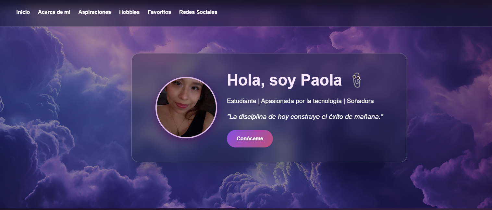
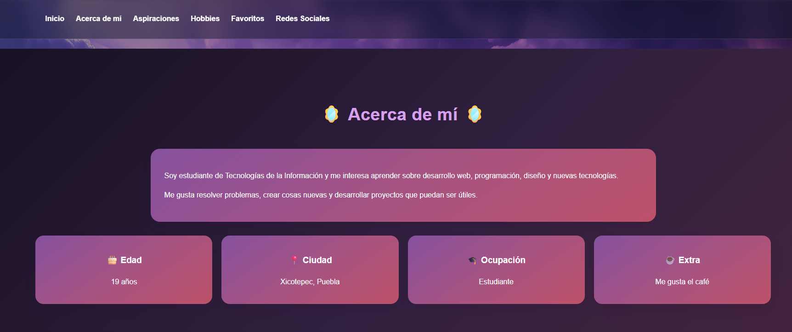
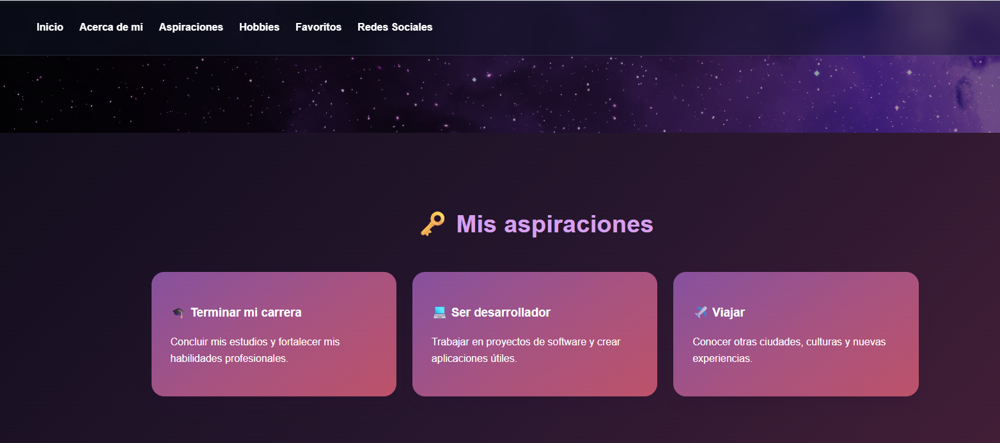
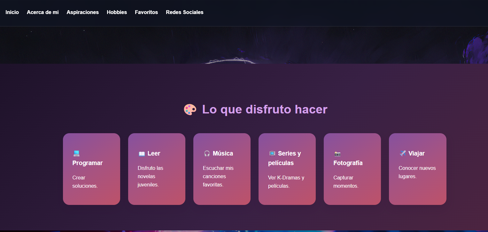
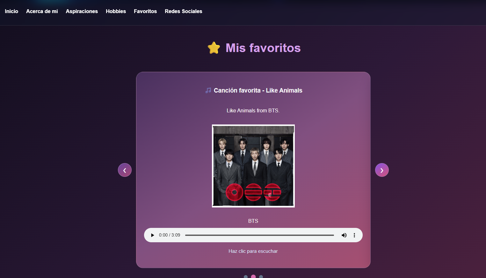
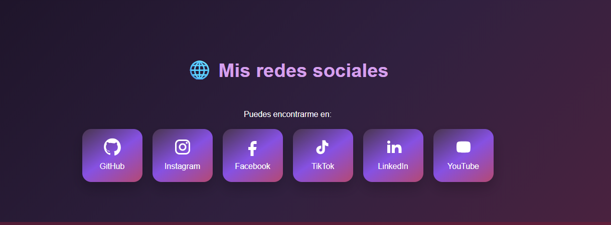
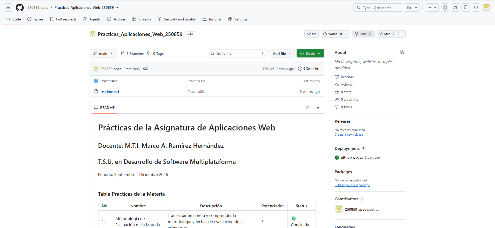
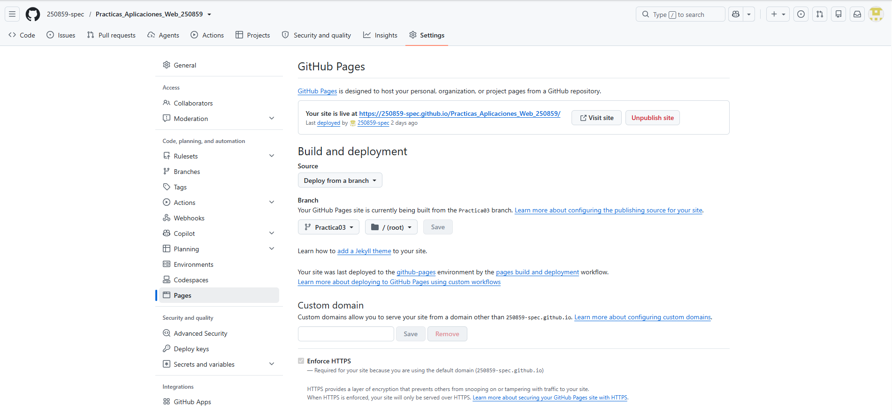

# Prácticas de la Asignatura de Aplicaciones Web
## Docente: M.T.I. Marco A. Ramírez Hernández
## T.S.U. en Desarrollo de Software Multiplataforma

Periodo: Septiembre - Diciembre 2026

---

### Tabla Prácticas de la Materia

|No.| Nombre | Descripción | Potenciador | Status |
|---|---|---|---|---|
|1.|Metodología de Evaluación de la Materia| Transcribir en libreta y comprender la metodología y fechas de evaluación de la asignatura| 5|🟢 Concluida|
|2.|Mi Primer Página Web| Codificar la primer página web con HTML puro, sin estilos ni funcionalidades| 10|🟢 Concluida|

# 🌐 Práctica 03: Mi Portafolio Web

## 📝 Descripción del proyecto

La Práctica 03 consiste en desarrollar un portafolio web personal titulado **“Mi Perfil”**, cuyo propósito es presentar diferentes aspectos del perfil estudiantil y personal mediante una página web con diseño personalizado.

El sitio integra secciones de navegación para mostrar información personal, aspiraciones, pasatiempos, contenidos favoritos y redes sociales. También incorpora recursos gráficos, tarjetas visuales y un carrusel interactivo para mejorar la presentación del contenido.

## 🎯 Objetivo de la práctica

Diseñar y desarrollar una página web personal utilizando HTML5, CSS3 y JavaScript, aplicando estilos personalizados, elementos interactivos y una estructura organizada, así como publicar el proyecto mediante GitHub Pages.

## 💻 Tecnologías utilizadas

- **HTML5:** estructura y organización del contenido de la página.
- **CSS3:** diseño visual, distribución de elementos, efectos y adaptación de la interfaz.
- **JavaScript:** programación de funcionalidades interactivas y del carrusel de favoritos.
- **Git:** control de versiones y registro de cambios.
- **GitHub:** alojamiento del repositorio y administración de ramas.
- **GitHub Pages:** publicación de la página web.

## ✨ Características principales

- Navegación entre las diferentes secciones del portafolio.
- Presentación del perfil personal y estudiantil.
- Sección de aspiraciones personales.
- Sección de pasatiempos.
- Presentación de contenidos favoritos.
- Carrusel interactivo con recursos multimedia.
- Integración de elementos gráficos e iconos.
- Enlaces a redes sociales.
- Estilos personalizados y efectos visuales.
- Adaptaciones para mejorar la visualización en diferentes tamaños de pantalla.

## 📂 Estructura del proyecto

El proyecto está organizado en carpetas para separar el código, los estilos y los recursos multimedia utilizados en el portafolio web.

```text
Practicas_Aplicaciones_Web_250683/
├── Practica02/
├── Practica03/
│   ├── assets/
│   │   ├── audios/
│   │   │   └── Body to Body - BTS.mp3
│   │   ├── documents/
│   │   │   └── A Tres Metros Sobre El Cielo - Federico Moccia.pdf
│   │   ├── images/
│   │   │   ├── book_portait.jpg
│   │   │   ├── captura-1.png
│   │   │   ├── captura-2.png
│   │   │   ├── captura-3.png
│   │   │   ├── captura-4.png
│   │   │   ├── captura-5.png
│   │   │   ├── captura-6.png
│   │   │   ├── captura-7.png
│   │   │   ├── feliz.png
│   │   │   ├── fondo-11.png
│   │   │   ├── fondo-12.png
│   │   │   ├── fondo-13.png
│   │   │   ├── fondo-14.png
│   │   │   ├── movie_portait.jpg
│   │   │   ├── perfil-3.png
│   │   │   ├── perfil-4.png
│   │   │   └── song_portait.jpg
│   │   └── videos/
│   │       └── Una chica del siglo XX (Tráiler) - Tráiler en Español _ Netflix.mp4
│   ├── css/
│   │   └── styles.css
│   ├── js/
│   │   └── app2.js
│   ├── index.html
│   └── readme.md
└── README.md
```

### Descripción de las carpetas

- **`assets/audios/`**: contiene los archivos de audio utilizados en el portafolio.
- **`assets/documents/`**: almacena los documentos PDF.
- **`assets/images/`**: contiene las imágenes, fondos y capturas de pantalla.
- **`assets/videos/`**: almacena los videos utilizados en el carrusel multimedia.
- **`css/`**: contiene los estilos visuales de la página.
- **`js/`**: contiene el código JavaScript para las funcionalidades interactivas.
- **`index.html`**: archivo HTML principal de la práctica.


## 🖼️ Capturas de pantalla

A continuación se muestran las capturas de las diferentes secciones de la Práctica 03: Mi Portafolio Web.

### Captura 1



### Captura 2



### Captura 3



### Captura 4



### Captura 5



### Captura 6




## 🔀 Control de versiones con Git y GitHub

Para organizar el desarrollo del proyecto se utilizó Git para registrar los cambios y administrar las ramas del repositorio.

El procedimiento realizado para integrar la Práctica 03 en la rama principal fue el siguiente:

1. Se trabajó en la rama `Practica03`, donde se realizaron los cambios del portafolio.
2. Se cambió a la rama `main`.
3. Se integraron los cambios de `Practica03` mediante un merge con la opción `--no-ff`, para conservar visible la unión de las ramas en el historial de Git.
4. Se enviaron los cambios integrados al repositorio remoto mediante `git push origin main`.
5. Posteriormente, se configuró GitHub Pages para publicar el sitio web.

### Comandos utilizados para integrar los cambios

```bash
git merge --no-ff Practica03 -m "Merge de Practica03 a main"
git push origin main
```

El uso de `--no-ff` permite crear un commit de merge explícito, haciendo visible la integración de la rama de la práctica con la rama principal en el historial del proyecto.

## 🚀 Publicación en GitHub Pages

Para publicar el portafolio web se siguió el siguiente procedimiento:

1. Se prepararon los archivos HTML, CSS, JavaScript y los recursos utilizados por la página.
2. Se verificaron las rutas de los archivos para permitir la carga correcta de los recursos.
3. Se registraron y sincronizaron los cambios mediante Git y GitHub.
4. Se accedió a la configuración del repositorio en GitHub.
5. En la sección **Settings → Pages**, se configuró la publicación desde una rama y la carpeta correspondiente.
6. Se obtuvo el enlace público de GitHub Pages y se verificó el acceso al portafolio.

### 📸 Captura 8 — Evidencia de GitHub Pages

Esta captura muestra evidencia del proceso de publicación del portafolio web mediante GitHub Pages.



### 📸 Captura 9 — Evidencia de GitHub Pages

Esta captura complementa la evidencia de la configuración y publicación del sitio web.



## 🌐 Enlace de la página web

**Mi Portafolio Web — GitHub Pages**

[https://250859-spec.github.io/Practicas_Aplicaciones_Web_250859/Practica03/](https://250859-spec.github.io/Practicas_Aplicaciones_Web_250859/Practica03/)

## 💡 Conclusiones sobre los conocimientos adquiridos

Durante el desarrollo de la Práctica 03 se reforzaron los conocimientos de HTML5 para estructurar una página web, CSS3 para personalizar su apariencia y JavaScript para implementar funcionalidades interactivas.

Asimismo, se practicó la organización de archivos y recursos, la creación y administración de ramas, el registro de cambios mediante commits y la integración de código con merge.

Finalmente, se comprendió el proceso de publicación de una página web mediante GitHub Pages y la importancia de verificar las rutas de los archivos y el funcionamiento de los recursos en el entorno publicado.

Esta práctica permitió integrar los conocimientos de desarrollo frontend y control de versiones mediante la creación y publicación de un portafolio web personal.